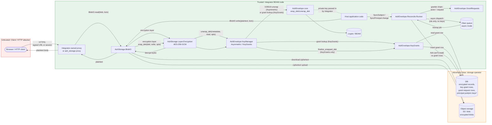

# Step 3: Artifacts

## System overview

`ash_envelope` is an Elixir library consumed by Ash applications. It exposes three concentric surfaces:

1. **Core crypto primitives** (`AshEnvelope.*`) — pure functions over binaries, no I/O.
2. **Key-grant management** (`AshEnvelope.KeyGrants`, `AshEnvelope.GrantRequests`) — Ash-resource-backed; reads and writes go through the integrator's Ash domain/Repo.
3. **BlobIO KeyManagers + reconciliation** (`AshEnvelope.BlobIO.KeyManagers.Asymmetric`, `AshEnvelope.BlobIO.KeyManagers.KeyGrants`, `AshEnvelope.Reconcile`) — KeyManager behaviours that plug into `AshStorage.Layer.Encryption`, plus a Spark DSL extension that keeps grants in sync with the encrypted resource's read policy.

The library never opens a network connection of its own. All persistence and authorization flow through Ash; all crypto flows through Erlang `:crypto`. All blob byte handling flows through `AshStorage.BlobIO`.

### BlobIO KeyManagers

`ash_envelope` ships two implementations of `AshStorage.Encryption.KeyManager`. Both plug into `AshStorage.Layer.Encryption`, which owns AES-256-GCM byte encryption; the KeyManager owns the DEK lifecycle:

| KeyManager | Trigger | What is persisted | Defends against |
|---|---|---|---|
| `Asymmetric` | `key_manager: {AshEnvelope.BlobIO.KeyManagers.Asymmetric, actor_public_key_attribute: …, actor_private_key_attribute: …}` | DEK wrapped (X25519 ECIES) to **one** actor's public key, stored in blob layer metadata | DBA-class threats and storage-backend disclosure (assuming principal private keys are protected per EA2). Single-recipient only. |
| `KeyGrants` | `key_manager: {AshEnvelope.BlobIO.KeyManagers.KeyGrants, grants_resource: …, domain: …, actor_public_key_attribute: …, actor_private_key_attribute: …}` | Pointer in blob layer metadata; the actual DEK is wrapped to each authorized principal's public key, one row per `(subject, principal)` in a dedicated grants table | DBA-class threats and storage-backend disclosure (EA2). Multi-recipient sharing and revocation, reconciled against the read policy. |

The `:simple` mode that earlier shipped with `AshEnvelope.Storage` is removed in v0.3.0; the configuration cliff it created (DEK in plaintext-equivalent form alongside the ciphertext) no longer exists.

## Architecture and trust boundaries

**\*** Whether principal private keys are stored in the DB at all is **integrator-defined**. The library only sees them as parameters to `unwrap_dek` and `resolve_for_actor`. EA2 requires that, if stored in the DB, they are KEK-encrypted (HSM/KMS/Cloak); the load-bearing nature of EA2 is called out below.

## Trust boundaries

| # | Boundary | What crosses |
|---|---|---|
| TB1 | **BEAM ↔ Database** | SQL queries containing wrapped DEKs, encrypted ciphertext, grant rows, grant-request rows, principal records (incl. KEK-protected private-key material per EA2). |
| TB2 | **BEAM ↔ Object storage** | Encrypted ciphertext only. No keys. URLs may be presigned. |
| TB3 | **BEAM ↔ Client (HTTP)** | Signed URLs (tokens), session cookies, decrypted plaintext on Plug response. Library makes no assumptions about transport beyond "use TLS" (EA4). |
| TB4 | **Process boundary (inside BEAM)** | Raw DEKs live in a single process's heap for the duration of a `BlobIO.write` / `BlobIO.read` call. The `KeyGrants` manager hands the DEK to `finalize_wrapped_dek/3` via a typed `WriteFinalization.handoff` field within the same `BlobIO.write` call — never via the process dictionary, never across processes. Async-mode Oban jobs explicitly carry **ids only**. The env seal key (A10), when expiring-grants are configured, lives in app-process memory after boot. |
| TB5 | **Library API ↔ Integrator code** | Plaintext, DEKs, principal public/private keys, actor structs. Library is fully trusting of the caller; integrator must authenticate the actor before passing it in. |
| TB6 | **Operator → app process (boot)** | The env seal key (A10) is written once at boot by the operator/orchestrator (typically env var or secrets-store unwrap) and lives in `Application.get_env(:ash_envelope, :seal_key)`. Only present when expiring-grants are configured. |
| TB7 | **Client → Object storage (signed URL paths)** | When the `ash_storage` proxy / serving layer emits a `service_url` (presigned PUT or GET), the client speaks directly to the backend bypassing the BEAM. **The encryption layer rejects direct uploads** (`AshStorage.Layer.Encryption.direct_upload/2` returns an error), so this boundary only carries ciphertext for unencrypted attachments. For encrypted attachments the encryption layer forces proxy URLs, routing reads back through TB3 + TB2. |

## Data flows

| # | From → To | Data | Sensitivity | Channel |
|---|---|---|---|---|
| F1 | Integrator → `AshEnvelope.encrypt/3` | Plaintext + 32-byte DEK + optional `:context` AAD (typically `to_string(record.id)`) | C-High, I-High | In-process call |
| F2 | `AshEnvelope.encrypt/3` → Integrator | `IV ‖ TAG ‖ ciphertext` (AAD-authenticated when `:context` was supplied) | C-Low (already ciphertext), I-High (AEAD + AAD binding) | Return value |
| F3 | Integrator → `AshEnvelope.wrap_dek` | DEK + recipient X25519 public key | C-High (DEK), I-High | In-process call |
| F4 | `AshEnvelope.wrap_dek` → Integrator | `eph_pub ‖ IV ‖ TAG ‖ wrap(DEK)` | C-Low (opaque wrap), I-High | Return value |
| F5 | Integrator → `AshEnvelope.unwrap_dek` | Wrapped blob + recipient X25519 private key | C-Very High (priv key), I-High | In-process call |
| F6 | `KeyGrants.create_for_actor` → Ash/DB | Base64(wrapped DEK), subject id, principal id | C-Low, I-High | Through Ash domain |
| F7 | `KeyGrants.resolve_for_actor` ↔ Ash/DB | Query by `(subject_id, principal_id)`; returns grant row | C-Low, I-High | Through Ash domain |
| F8 | `KeyGrants.share` flow | Reads granter's grant → unwraps with granter's priv key → re-wraps for target's pub key → inserts target's row | C-Very High in memory; C-Low at rest | Through Ash domain |
| F9 | `KeyGrants.revoke` → Ash/DB | `Ash.destroy` on grant row, `authorize?: true` by default | I-High | Through Ash domain |
| F10 | `BlobIO.Layer.Encryption.write` → service upload | Ciphertext (post-encrypt) + layer metadata persisted on blob | I-High | Inner storage backend |
| F11 | `KeyManagers.KeyGrants.wrap_dek` → typed handoff | DEK carried on `Writer.Operation.write_finalizations` to `finalize_wrapped_dek/3` after blob creation, all within the same `BlobIO.write` call. | C-Very High, transient | In-process, typed field |
| F12 | `finalize_wrapped_dek/3` → `KeyGrants.create_for_actor` | Wraps for actor, inserts grant row keyed by blob id | C-High → C-Low | In-process + Ash domain |
| F15 | `BlobIO.read` (encryption layer) → `:crypto` | Ciphertext + DEK (resolved by configured KeyManager) | C-Very High (DEK) | In-process |
| F16 | `Reconcile.Runner.plan` → Ash/DB | `Ash.can?(:read, subject, actor: principal)` evaluations (`maybe_is: false`, under the triggering tenant); grant existence query (system-side, expiry-aware, since the 2026-10 review pass) | I-Medium | Ash policy / domain |
| F17 | `Reconcile.Runner.apply_plan!` (`:actor` granter) | Reads granter's grant + private key, unwraps, re-wraps for target, inserts | C-Very High in memory | In-process + Ash domain |
| F18 | `Reconcile.Runner.apply_plan!` (`:request` granter) | Inserts pending row in `GrantRequests` | C-Low, I-High | Ash domain |
| F19 | `Reconcile` async dispatch → Oban | `%{subject_ids, principal_id, actor_id}` — **never keys, never DEKs**. Since the 2026-10 review pass also the serialized tenant; the job is inserted inside the triggering transaction. | C-Low, I-High | Oban job args (DB) |
| F20 | `GrantRequests.fulfill` | Same as F8 but consults pending-request table; concurrent-safe | C-Very High in memory | In-process + Ash domain |
| F21 | `Reconcile.revoke_entry` → DB | `authorize?: false` destroy on grants + pending requests; system-side | I-High | Ash domain |
| F22 | `KeyGrants.create_ephemeral` → `SealKey.seal` → Ash/DB | Seal the DEK under A10 with AAD = subject id; insert row with `principal_id IS NULL`, sealed `wrapped_dek`, `expires_at` | C-Very High in memory; C-Low at rest | In-process + Ash domain |
| F23 | `KeyGrants.resolve_ephemeral` ↔ Ash/DB | Query by `(subject_id, principal_id IS NULL)`; TTL check; `SealKey.unseal` | C-Very High (DEK transient) | In-process + Ash domain |
| F24 | Operator → `Application` env | Seal key bytes (32) once at boot | C-Very High | Out of band (env var / secrets store) |
| F25 | Operator → `Application` env / IAM | Storage-service credentials (S3 keys, disk HMAC secret, Azure SAS) once at boot | C-Very High | Out of band (env var / IAM / secrets store) |
| F26 | Variant generator → `BlobIO.read` → temp file | Decrypted source bytes written to a process-owned temp file, transform reads it | C-Very High (DEK transient in process; plaintext on disk for transform duration) | In-process + local fs |
| F27 | Variant generator → `BlobIO.write` | Transform output re-encrypted via the same layer chain as the parent blob | C-Low at rest | In-process + storage adapter |
| F28 | `AshStorage.Layer.Encryption.direct_upload/2` → error | The encryption layer **refuses** to participate in direct uploads (`{:error, …}`) | — | In-process |
| F29 | `AshStorage.Layer.Encryption.serving/2` → proxy URL | Encryption layer rejects `service_url` strategies and forces proxy URLs for encrypted blobs; integrator's signed-token bearer auth gates the proxy | C-Low (only signed-token + URL) | HTTPS |
| F30 | `Mirror` service write → primary + fan-out secondaries | Ciphertext upload propagated to N backends; partial failures on secondaries can leave orphans | I-High (at rest) | Storage adapters |

## Legitimate use cases

| ID | Actor | Goal | Main flow |
|---|---|---|---|
| UC1 | Integrator developer | Encrypt a per-record field with a DEK managed by `KeyGrants` (multi-recipient access) | `dek = generate_dek(); ct = encrypt(plaintext, dek, context: to_string(record.id))` → store `ct` on the record; for each recipient `KeyGrants.create_for_actor(config, record.id, dek, recipient, domain)`. Adding / revoking recipients = grant-row management. AAD binds the ciphertext to the row. For single-key field encryption with one app-wide vault key, see [`ash_cloak`](https://hexdocs.pm/ash_cloak) — different use case. |
| UC2 | Integrator developer | Multi-recipient encrypted storage | Configure `AshStorage.Layer.Encryption` with `AshEnvelope.BlobIO.KeyManagers.KeyGrants`; `BlobIO.write` runs the encryption layer, which calls `wrap_dek` and (after blob creation) `finalize_wrapped_dek/3` to insert the grant row. |
| UC3 | End user | Read their encrypted attachment | Integrator route or upstream proxy calls `AshStorage.BlobIO.read/3` with the actor; encryption layer's `unwrap_dek` resolves the grant by `(subject_id, current_user.id)` and returns plaintext. |
| UC4 | Granter user | Share a record with another principal | `KeyGrants.share(...)` — unwrap with granter's privkey, re-wrap for target's pubkey, insert row |
| UC5 | Admin | Revoke a single principal's access | Delete that principal's grant row; other principals' rows and DEK unaffected |
| UC6 | Integrator framework | Auto-reconcile grants after a membership change | `SyncPrincipal` change → `Runner.plan/apply_plan` → `:actor` strategy re-wraps or `:request` queues pending |
| UC7 | Authorized user (later) | Fulfill outstanding requests they can | `GrantRequests.fulfill_outstanding` — for each request whose subject they hold a grant on, re-wrap to target |
| UC8 | Deferred Oban analyzer | Decrypt a blob without a user actor in scope | `BlobIO.read` with `operation: :analyze`, `analyzer: <mod>`, `actor: nil`. `KeyGrants` manager routes through `resolve_ephemeral/3`, which unseals the row's DEK using A10. Requires the integrator to opt into expiring-grants on the `KeyGrants.Config`. |
| UC9 | Integrator developer | Give a user time-bounded access to a record | `create_for_actor/6` with `expires_at:`. Reads stop succeeding past the deadline; the same TTL purge job that handles ephemeral rows also handles expired user grants. Requires opt-in on the `KeyGrants.Config`. |
| UC10 | `ash_storage` variant generator | Produce a thumbnail / derived blob from an encrypted source | Download source via `BlobIO.read/3` (decrypts), write plaintext to a process-owned temp file, run integrator-supplied `transform/3`, read result, upload via `BlobIO.write/3` (re-encrypts via the same layer chain), insert variant blob row. Temp file removed in the `finally` path. DEK is transient in process memory; no plaintext at rest on the parent record. |
| UC11 | End user | Upload a large file directly to the storage backend, bypassing the BEAM | `AshStorage.Operations.prepare_direct_upload/3` issues a presigned PUT URL. **If the attachment is encrypted, the encryption layer's `direct_upload/2` returns `:error` and no URL is issued.** Direct uploads are only available for plaintext attachments. |

## Misuse cases

DBA-class adversaries can read and modify any row at will. Total destruction (drop tables, delete grants, corrupt rows) is **out of scope as a class** — it is intrinsic to a hostile DBA and cannot be defended at the library layer. The interesting question across the table below is **whether the library's design lets a hostile DBA breach confidentiality of plaintext (A1) despite EA2 holding**.

Conclusion in advance: under EA2 (private keys protected outside the DB), the library's design holds. The only confidentiality breach available to a DBA is an integrator-side configuration choice: an EA2 violation (MC4').

| ID | Threat actor | Goal | Approach | Outcome / library defence |
|---|---|---|---|---|
| MC1 (S) | Network attacker on the inner storage link | Spoof / substitute a ciphertext blob | Replace bytes in S3 / on disk | AEAD tag (GCM) makes any tamper fail closed on decrypt (`{:error, :decryption_failed}`). |
| MC2 (T) | DBA | Swap a wrap blob from `(subject, P_x)` into `(subject, P_y)` | Row-level update | `P_y`'s privkey can't open a wrap made for `P_x` → `:decryption_failed`. **DoS only; confidentiality preserved** (the wrap is cryptographically bound to the recipient pubkey). |
| MC3 (T) | DBA | Move a wrap from `(A1, P)` into `(A2, P)`, or insert a forged `(A, attacker_principal)` row with a wrap-to-self of a chosen DEK | Row-level insert/update | The DEK that decrypts ciphertext is the per-record one. Any swapped wrap returns either a different DEK (AEAD-fails on the ciphertext) or a DEK chosen by the attacker (AEAD-fails on the unchanged ciphertext). **DoS only; confidentiality preserved.** |
| MC3b (T) | DBA | Substitute the **whole envelope** (ciphertext + every grant row) with attacker plaintext, using a fresh DEK wrapped to each principal's public key | Bulk overwrite | Principals decrypt and see attacker-chosen plaintext under the original record's identity. **Integrity / authenticity attack, not confidentiality** — the attacker does not learn the original plaintext. Defence is integrator-side row signing / append-only audit (out of library scope). |
| MC4 (I) | DB reader | Read plaintext from the encrypted database | SELECT on encrypted column / blob | Confidentiality from AES-256-GCM + X25519 wraps. **No breach under EA2.** |
| MC4' (I) | DB reader / DBA | Exploit an **EA2 violation**: read principal private keys stored plaintext in the DB | SELECT on `users.private_key` | Library cannot defend. Private keys must be KEK-protected outside the DB (EA2). Generator templates and docs must steer integrators toward Cloak / KMS / HSM. |
| MC5 (I) | Process inspector on BEAM | Read DEK from process heap | Memory dump | Out of scope (host trust, EA5). No process-dictionary handoff exists; DEKs only live in the heap during the `BlobIO.write` / `BlobIO.read` call. |
| MC6 (I) | Log / telemetry reader | Recover key material from logs | Crash dump, telemetry events | Library does not log keys or plaintext. Errors return tagged tuples (`:decryption_failed`) without key context. Reconcile logs `{principal_id, subject_id}` only. Integrator must avoid logging actor structs verbatim. |
| MC7 (I) | DB reader | Use grant-relationship metadata to infer who-has-access-to-what | SELECT `principal_id` from `key_grants` grouped by subject | Inherent to the grants-table design; **not** hidden by the library. Captured under A6 privacy. |
| MC8 (D) | Authenticated app user | Strand other users by mass-deleting their grants | Call `KeyGrants.revoke` from a UI path | `authorize?: true` default on public API; revocation goes through Ash policies on the grants resource. Library does not bypass authorization on public path. |
| MC9 (D) | External attacker | Fill `GrantRequests` with junk pending rows | Trigger reconciliation by manipulating affecting resources | Idempotent against `(subject, target, pending)` identity; one pending row per `(subject, target)`. Higher-level rate-limiting is integrator's job. |
| MC10 (E) | Authenticated app user without a grant | Bypass the proxy and read someone else's attachment | Request `/storage/<known-key>` | `BlobIO.read/3` decrypts via the `Encryption` layer, which calls the configured KeyManager with the actor on the read context. Without the right actor's private key (Asymmetric) or grant row (KeyGrants), `unwrap_dek/3` returns an error and no plaintext escapes the layer. The HTTP-surface hardening (path traversal, signed URLs, disposition encoding) is the upstream `ash_storage` proxy's responsibility, not `ash_envelope`'s. |
| MC11 (E) | Malicious caller of `KeyGrants.share` | Get a grant for an arbitrary principal | Call `share` with a target they shouldn't be able to grant to | Library does not enforce *who-may-share-with-whom* — that is the integrator's policy on the grants resource. Captured in EA3. |
| MC12 (E) | Reconciliation bug | Wrap a DEK for the wrong principal | Granter strategy or plan miscomputation | Truth model (`Ash.can?(:read, subject, actor: principal)`) and per-row binding via `(subject_id, principal_id)`. Testing burden on reconciliation invariants. The 2026-10 review found this truth model undermined in practice (planner blind to policy-protected grants, `:maybe` treated as allow, empty-scope and cross-tenant fan-out, moved-scope stale grants); see T6 in `04_risk_assessment.md`. |
| MC13 (I) | Oban job-row reader | Recover keys from queued reconciliation jobs | Read `oban_jobs.args` | Async mode by design only serializes `subject_ids + principal_id + actor_id`. No DEK or private key. Worth a regression test that asserts no key material in `Oban.Job.args`. |
| MC14 (T) | Bit-flip in DB | Silent corruption of ciphertext / wrap | Hardware error | GCM/ECIES tag detects; decrypt returns `:decryption_failed`. |
| MC15 (S) | Attacker controlling actor struct | Pass a forged actor map with attacker-controlled `:id` | Integrator hands an untrusted actor to library | Out of scope; captured in EA1. |
| ~~MC16 (I)~~ | ~~DBA, against `:simple`-mode deployment~~ | **Retired in v0.3.0.** The `:simple` storage mode is removed; no code path in `ash_envelope` persists a DEK alongside its ciphertext. Single-recipient deployments use `Asymmetric`; the upstream `KeyManagers.Cloak` covers vault-based custody. |
| **MC17 (I)** | **Attacker with the backup private key** | Recover plaintext for every blob written while that key was current | Read `wrapped_dek["backup"]` from blob layer metadata, X25519-unwrap, AES-256-GCM decrypt | **No cryptographic defence — by design of the backup-escrow path.** The recovery path is gated only by possession of the private key. The library narrows the *code* surface that can reach it (recovery is in `AshEnvelope.recover_dek/2`, not in any configured KeyManager — SR19) and binds custody to EA9 (cold storage / KMS / split-key). Rated T15 — Undesirable under EA9, becoming Inacceptable if EA9 is violated. |
| **MC18 (Av)** | **Operator retiring previous backup key before rotation completes** | Make backup-recovery unavailable for un-rotated blobs | Drop `:backup_public_key_previous` from config and destroy the private key while some blobs still carry an old `key_id` | Mitigated by `mix ash_envelope.rotate_backup_key` (SR20): the CLI exits non-zero when any blob remains wrapped to a non-current key after the pass, and `--check-only` provides a pre-flight count. Per-principal grants are unaffected — this is an availability loss only for the escrow path. |
| **MC19 (I)** | **Attacker with the env seal key (A10) and DB read** | Recover plaintext of every blob whose ephemeral row is currently live | Walk `key_grants WHERE user_id IS NULL`, unseal `wrapped_dek` under A10, decrypt the ciphertext | **Bounded by TTL × write rate.** Defence: A10 is opt-in via EA10; the seal key alone (without DB read) decrypts nothing; AAD on the seal binds the row to its subject id so row-shuffling fails closed; the TTL purge enforces a finite blast-radius window. Rated T18 — Undesirable. |
| **MC20 (Av)** | **Caller of `renew_ephemeral/5` passes the wrong DEK** | Replace the legitimate ephemeral row with one that decrypts to garbage | Direct call with wrong bytes | Developer-error class, not an attack. Recovery is calling `renew_ephemeral_with_actor/5` with the correct authority. Rated T19 — Tolerable; mitigated by API shape (the `_with_actor` variant is the primary admin path). |
| **MC21 (E)** | **Time-bounded user grant outlives the policy intent** | Keep access past `expires_at` when the read policy still authorizes | Integrator issued a grant with `expires_at = trial_end` but the read policy doesn't encode the bound | Captured by SR27 — the read policy is the access-control truth; `expires_at` is grant-lifecycle convenience. Integrators who need permanent revocation must encode it in the policy. Rated T20 — Inacceptable conceptually but downstream of EA3. |
| **MC22 (E)** | **Unauthenticated proxy bypass on serving** | Read a victim's encrypted blob via the ash_storage proxy without holding a valid signed-token bearer | Forge / replay a proxy URL with a stale or guessable token | Integrator-owned: the encryption layer forces proxy URLs and sets `access: {:signed, secret: secret}`, but token generation, expiry, and rotation are the proxy route's responsibility. T9 (returns in v0.4-dev scope). Defence is SR31 (documented responsibility) + the existing `BlobIO.read/3` invariant that without an actor / grant the read fails. |
| **MC23 (I)** | **Plaintext temp-file persistence after variant transform** | Recover plaintext from a temp file left behind by a variant transform | Cause the transform process to crash without cleanup; read `/tmp` between transform finish and cleanup | Bounded — `ash_storage`'s variant generator wraps the transform in a `try/finally` that `File.rm/1`s the temp file. Plaintext on disk is microseconds in the happy path. Captured by T21 / SR29. The remaining window is host-trust (EA5). |
| **MC24 (S)** | **Direct upload bypass against an encrypted attachment** | Use a presigned PUT URL to upload attacker-chosen plaintext under a blob key bound to an encrypted attachment | Obtain a presigned URL through normal flow, push arbitrary bytes | The encryption layer's `direct_upload/2` returns an error — no presigned URL is ever issued for an encrypted attachment. If the integrator sidesteps the layer chain and manually issues a presigned URL, downstream reads fail closed at AEAD verification (T22 / SR28). |
| **MC25 (I/Av)** | **Mirror partial-write orphans** | Leave inconsistent ciphertext across mirror backends, then exploit primary-elected read fallthrough to mask a tamper | Cause the secondary upload to fail after the primary succeeds | The mirror service halts the write on primary failure but reports partial-failure asynchronously when secondaries fail. Recovery is integrator-owned: re-upload or trim orphans. Captured by T23. AEAD on the ciphertext prevents tamper-without-detection — DoS only. |
| **MC26 (I)** | **Storage-service credential leak** | Read every ciphertext blob (S3 SELECT), or write attacker plaintext for T4-class envelope substitution | Exfiltrate IAM keys from process env, build images, logs, or runtime config | A11 confidentiality. Read alone does not break ash_envelope's confidentiality (the wraps still hold). Write enables T4. Captured by T24 / EA11. |

## Assumptions used in this analysis

| ID | Assumption | Load-bearing? |
|---|---|---|
| EA1 | Integrator authenticates the `actor` map before passing it to AshEnvelope APIs; `actor.id` is bound to a real authenticated principal. | Yes — defeats spoofing class. |
| **EA2** | **Integrator stores principal X25519 private keys with at least the same protection as the encrypted data itself** (KEK from KMS/HSM, app-level encryption like Cloak). They are not in the same DB column as wrapped DEKs in plaintext form. Library treats private keys as opaque parameters. | **Load-bearing — this is the single assumption that turns the library's design from "no DBA confidentiality breach" to "all bets off."** |
| EA3 | Integrator's Ash policies on the `KeyGrants`, `GrantRequests`, and encrypted resources correctly enforce "who may read / share / revoke." Library defaults are `authorize?: true` on the public API. | Yes — covers MC11. |
| EA4 | Transport between client and BEAM node uses TLS; transport between BEAM node and DB / object storage uses TLS where applicable. | Standard. |
| EA5 | Host OS / BEAM node integrity is not in scope (no side-channel, no rogue NIF, no `Process.info` adversary). | Standard. |
| EA6 | The `:async` reconciliation mode runs on an Oban queue whose persistence is at least as trusted as the integrator's main DB; the job args contain only ids (verified by F19). | Yes — covers MC13. |
| EA8 | Cryptographic algorithms used (AES-256-GCM, X25519, HKDF-SHA256) remain acceptable per BSI TR-02102 horizon 2030; quantum adversaries out of scope. | Standard. |
| **EA9** | **Backup private key (when `:backup_public_key` is configured) is stored at ≥ plaintext protection, outside the application DB.** Cold storage / KMS / split-key. Only online for recovery or rotation. | **Load-bearing for T15 when backup escrow is in use.** |
| **EA10** | **When expiring-grants are configured (`:expires_at_attribute` set on `KeyGrants.Config`), the env seal key (A10) is sourced from an operator-managed secret (env var, secrets store, KMS bootstrap)** and treated as application-level secret material. Storage in source control, in build images alongside ciphertexts, in logs, or in error reports is excluded. Rotation is via "drain via TTL": set new key, wait for the maximum configured TTL, retire the old key. | **Load-bearing for T18 when expiring-grants are in use.** Weaker than EA9 by design (the seal key is reached by every analyzer run and can't realistically live in cold storage); the TTL is the compensating control. |
| **EA11** | **Storage-service credentials (A11) are sourced from operator-managed config / IAM** (cloud IAM with instance roles, secrets store, KMS-unwrapped env, etc.). Storage in source control, in build images alongside ciphertexts, in container `ENV` layers committed to a registry, in logs, or in error reports is excluded. The disk-service HMAC signing secret falls under the same regime. Credential rotation is the integrator's responsibility; ash_envelope provides no rotation tooling for storage-service credentials. | **Load-bearing for T24** — confidentiality of the wrapped DEKs holds even under credential leak (read alone), but write-capable credentials enable T4-class envelope substitution. |

## Carry-over to step 6 (optional hardening, not critical)

- **AAD binding on `wrap_dek`.** Currently `wrap_dek/2` passes `""` as AAD. Binding `subject_id ‖ principal_id` (or the grant row's identity) into the AEAD would convert silent decryption failures on row shuffling into explicit binding errors. **Does not add a new confidentiality guarantee** — X25519 recipient binding already covers it — but improves debuggability and defence in depth.
- **Generator templates that nudge integrators away from storing private keys in plain DB columns.** Counters MC4' by making the EA2-violating configuration awkward to scaffold.
