# User-driven fulfillment

The `:request`-by-default reconciliation pattern: instead of fanning grants
out inline (or even in a server-side worker that decrypts other users'
private keys), the encrypted resource's affecting actions write **pending
grant requests** to the database. An authorized user later opens an "Apply"
page in their session, where their own private key is available, and
fulfills the queued requests one at a time.

This is the architecture you want when:

- The fan-out scope is large (admin promotion across thousands of subjects)
  and you don't want the trigger request to wait.
- You plan to migrate user private keys from server-decryptable storage
  (cloak/vault) to passphrase- or passkey-derived keys, where the server
  cannot autonomously decrypt anyone's private key. In that future state,
  *only* the user's live session can perform a rewrap, and this pattern is
  the primary path.

## The flow at a glance

```mermaid
flowchart TD
    Action["Affecting action commits<br/>(membership added, role changed,<br/>fresh upload, ...)"]:::trigger
    Action --> SP["SyncPrincipal after_transaction<br/>(or SyncSubject for fresh upload)"]:::trigger
    SP --> Mode{"reconcile<br/>mode ?"}:::trigger
    Mode -->|":sync"| Chain
    Mode -->|":async"| Enqueue["Resolve scope to subject_ids<br/>(one filtered SELECT)<br/>Enqueue Oban job(s)"]:::trigger

    Enqueue -->|"args: {encrypted_resource,<br/>principal_id, actor_id, [subject_ids]}<br/>NO key material"| Job[("Oban<br/>jobs table")]:::store
    Job --> Worker["AsyncWorker.perform"]:::worker
    Worker --> LoadActor["Load actor by id<br/>cloak-decrypts private_key<br/>via server vault"]:::worker
    LoadActor --> Chain

    Chain["Granter chain<br/>per (principal, subject) pair"]:::chain
    Chain --> S1{"{:dek_from_process,<br/>when: self_or_backup?}"}:::chain
    S1 -->|matches: target == actor<br/>or target.role == :backup<br/>and DEK in process dict| G1["KeyGrants.create_for_actor<br/>(wraps DEK from process<br/>for target's public key)"]:::chain
    S1 -->|skip| S2{"{:actor,<br/>when: self_or_backup?}"}:::chain
    S2 -->|matches and<br/>actor holds the grant| G2["KeyGrants.share<br/>(actor unwraps DEK<br/>and rewraps for target)"]:::chain
    S2 -->|skip| S3[":request"]:::chain
    S3 --> ReqRow["GrantRequests.create<br/>(insert pending row<br/>or no-op if already pending)"]:::chain

    G1 --> Grants[("EvidenceKeyGrant<br/>(blob_id, user_id, wrapped_dek)")]:::store
    G2 --> Grants
    ReqRow --> Pending[("EvidenceGrantRequest<br/>(blob_id, user_id, fulfilled_at)<br/>fulfilled_at IS NULL")]:::store

    Pending --> LV["LiveView 'Pending grants' page<br/>list_fulfillable_for(actor)"]:::apply
    LV --> Click["User clicks 'Apply'"]:::apply
    Click --> Task["Task.Supervisor.async_nolink<br/>(linked to LV pid;<br/>dies on navigate-away)"]:::apply
    Task --> Fulfill["Runner.fulfill_pending<br/>per request:<br/>• load target user<br/>• KeyGrants.share from actor<br/>• mark fulfilled_at"]:::apply
    Fulfill --> Progress["send {:progress, meta}<br/>→ handle_info<br/>→ progress bar"]:::apply
    Fulfill --> Grants
    Fulfill -.idempotent.-> Pending

    Grants --> Read["Read path:<br/>actor's private_key<br/>unwraps DEK<br/>→ AshStorage.Layer.Encryption decrypts blob"]:::read

    classDef trigger fill:#dbeafe,stroke:#1e40af,color:#1e3a8a
    classDef worker fill:#fef3c7,stroke:#92400e,color:#78350f
    classDef chain fill:#dcfce7,stroke:#166534,color:#14532d
    classDef apply fill:#fce7f3,stroke:#9d174d,color:#831843
    classDef store fill:#e5e7eb,stroke:#374151,color:#111827,font-style:italic
    classDef read fill:#ede9fe,stroke:#5b21b6,color:#4c1d95
```



**Reading the diagram.** The blue band is the originating request — fast,
deterministic, returns as soon as the Oban job is enqueued. The amber band
is the worker (only present when `mode :async`); it's where the per-pair
work happens. The green band is the granter chain that gates whether each
pair becomes an inline grant or a queued request. The pink band is the
LiveView Apply page where a logged-in user with a session-side private
key fulfills the pending requests. The grey ellipses are persistent state.

The arrows from `:dek_from_process` and `:actor` to `EvidenceKeyGrant`
are the only paths that ever wrap a DEK against a public key — every
other path defers the wrap to a logged-in user's session. **No
third-party private key ever rides through an Oban job or the
worker's process.**

## The pieces

Three primitives in `ash_envelope` cooperate:

| Primitive | Phase | What it does |
|---|---|---|
| `granter_chain` `when:` filter | trigger | Constrains which strategies fire inline. Most targets fall through to `:request`. |
| `Reconcile :async` mode | trigger | The trigger enqueues an Oban job instead of running the chain inline. |
| `Runner.fulfill_pending/3` | apply | Walks pending request rows and rewraps from the current actor's session. Streams progress via callback. |

## 1. Configure the chain

The `:when` predicate gates `:actor` and `:dek_from_process` so they only
fire when the target is the actor themselves or the recovery backup
recipient. Everyone else lands on `:request`.

```elixir
reconcile do
  user_resource MyApp.User
  grant_requests_resource MyApp.GrantRequest

  mode :async                     # default-async trigger; see below
  oban_queue :ash_envelope_reconcile

  granter_chain([
    {:dek_from_process,
     key_for: &__MODULE__.storage_key/1,
     when: &__MODULE__.self_or_backup?/2},
    {:actor, when: &__MODULE__.self_or_backup?/2},
    :request
  ])
end

def self_or_backup?(target, %{actor: %{id: actor_id}}) when not is_nil(actor_id),
  do: target.id == actor_id or target.role == :backup
def self_or_backup?(_, _), do: false
```

The 2-arity `:when` predicate receives the loaded target principal and
the runtime `%Context{}`. Return anything other than `true` to skip the
strategy and fall through to the next one.

## 2. Async trigger

With `mode :async`, the trigger does almost no work in `after_transaction`:
it resolves the scope to a list of subject ids (one cheap filtered SELECT)
and enqueues an `AshEnvelope.Reconcile.AsyncWorker` job per
`oban_chunk_size` (default 5000) ids. The job carries:

- the encrypted resource module name (string)
- the principal id (the user whose authorization changed)
- the actor id (whoever triggered the change; may be `nil`)
- the chunk of subject ids

**No key material rides in the args.** The actor's private key lives in
the user table — cloak-encrypted at rest today, passphrase-derived in
the future — and the worker re-loads the actor by id to pick it up.
With `:request`-by-default the worker mostly inserts pending request
rows; the only inline rewraps are for the `self_or_backup?` cases where
the actor is also the target.

If you don't want the Oban hop, set `mode :sync` per resource. The
trigger then runs the chain inline as before.

## 3. The Apply page

A LiveView page lists each user's fulfillable pending requests and runs
`Runner.fulfill_pending/3` in a supervised task on click. The user's
session holds the rewrap key, so the worker process is the user's
LiveView, not Oban.

```elixir
defmodule MyAppWeb.PendingGrantsLive do
  use MyAppWeb, :live_view

  alias AshEnvelope.GrantRequests
  alias AshEnvelope.Reconcile.{Info, Runner}

  @impl true
  def mount(_params, _session, socket) do
    actor = socket.assigns.current_user

    {:ok, ctx} = Info.context(MyApp.Document)
    {:ok, requests} =
      GrantRequests.list_fulfillable_for(
        ctx.grant_requests_config,
        ctx.key_grants_config,
        actor,
        ctx.domain
      )

    {:ok,
     assign(socket,
       requests: requests,
       progress: nil,
       summary: nil,
       running?: false
     )}
  end

  @impl true
  def handle_event("apply", _params, socket) do
    actor = socket.assigns.current_user
    requests = socket.assigns.requests
    pid = self()

    {:ok, ctx} = Info.context(MyApp.Document)
    ctx = %{ctx | actor: actor}

    Task.Supervisor.async_nolink(MyApp.TaskSupervisor, fn ->
      Runner.fulfill_pending(ctx, requests,
        on_progress: fn meta -> send(pid, {:progress, meta}) end
      )
    end)

    {:noreply, assign(socket, running?: true, progress: %{done: 0, total: length(requests)})}
  end

  @impl true
  def handle_info({:progress, %{done: d, total: t} = meta}, socket) do
    {:noreply, assign(socket, progress: %{done: d, total: t, last: meta})}
  end

  # Task.async_nolink delivers the final return value here.
  def handle_info({ref, summary}, socket) when is_reference(ref) do
    Process.demonitor(ref, [:flush])
    {:noreply, assign(socket, summary: summary, running?: false)}
  end

  def handle_info({:DOWN, _ref, :process, _pid, _reason}, socket) do
    {:noreply, assign(socket, running?: false)}
  end
end
```

The `Task.Supervisor.async_nolink` call links the rewrap work to the
LiveView's lifecycle: if the user navigates away or refreshes, the
LiveView pid dies and the task dies with it. Partial progress is fine —
`Runner.fulfill_pending/3` is idempotent against the request table's
`is_nil(fulfilled_at)` guard, so re-clicking Apply on a partly-processed
list resumes correctly.

## Pitfalls

- **Stale requests.** A request can outlive the policy reason that
  created it (membership ended, role changed). Add a periodic AshOban
  trigger that walks pending rows and revokes any where
  `Ash.can?(:read, subject, actor: target)` is now false. Use
  `AshEnvelope.GrantRequests.revoke_pending_for/4`. Skip until you
  observe queue growth.
- **Target user gone.** If the target was deleted between request
  creation and fulfillment, `fulfill_pending` returns `:target_not_found`
  in the per-row error list. The other rows still process.
- **Concurrent fulfillers.** Two authorized users may click Apply on
  overlapping request sets. The underlying `KeyGrants.share/5` and the
  `GrantRequests.fulfill/6` `is_nil(fulfilled_at)` guard make this
  race-safe — duplicates collapse to `:skipped`.
- **Authorization revoked between request and apply.** The policy may
  no longer authorize the target. `fulfill_pending` does not re-check
  by default; if you need that property, run a sweep (above) before
  applying, or wrap each call in a per-request `Ash.can?` check.
- **Visibility.** Pending request rows are user-visible (an audit
  surface). Do not store anything in `reason` that the target user
  shouldn't see. The default schema only stores ids and timestamps.
